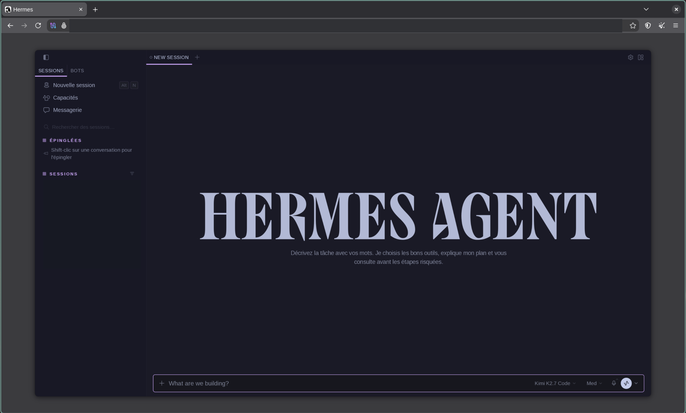

# Styx

Access your Hermes web UI through Tor Browser.
One onion address, one password. No ports exposed to your local network.


## 1. Install

On the machine running **Hermes ≥ 0.22.0**, open a terminal:

```bash
hermes plugins install CloudDown/styx
hermes styx setup
```

Hermes prompts for dependency installation and plugin activation. Approve these to continue. If you leave the plugin disabled, run `hermes plugins enable styx` before setup.

Setup asks for a password, prepares the webapp and starts Styx. Choose a long, unique passphrase; existing passwords are never overwritten. If Tor is missing, setup offers to install it through your existing package manager, with your confirmation.

Linux, macOS and native Windows are supported. Windows requires a filesystem with private ACLs, normally NTFS. Platform prerequisites and manual Tor setup are covered in the [guide (French)](docs/GUIDE.md#linux-macos-et-windows). Autostart and dashboard/API calls never install system packages.

## 2. Open the passage

```bash
hermes styx url
```

Styx asks Hermes to prepare the webapp (reusing a fresh bundle or building a missing/outdated one), enables it, and starts or restarts the gateway if needed. It checks the actual HTTP response, not merely an open port. Copy the displayed address **into Tor Browser**, then enter your password. Keep the host machine awake; Tor can add latency.

After Cerberus, Styx uses Hermes' official one-use launch flow to sign the tab in automatically. You do not need to run `hermes webapp` manually. New tabs and reloads are handled too, without disabling Hermes authentication or modifying its code. An additional Hermes sign-in provider, if explicitly configured, is still respected.



Hermes in Tor Browser. The onion address and session list are redacted for privacy.

Rebuilding an interface on a running gateway does not restart Hermes or its bots. Build errors point to `plugin-data/styx/logs/webapp-build.log`; startup does not report success with a missing-interface error page.

Your address stays the same across stops and restarts. Keep it private, even though a password is still required to get in.

## 3. Close it

```bash
hermes styx stop
```

Only Tor and Cerberus stop. Hermes and its bots keep running.

## Commands

Every host command is under `hermes styx`; running it without a subcommand prints the list.

### Start and stop

| Command | What it does |
|---|---|
| `hermes styx setup [--client-auth] [--no-wait]` | First run: offers Tor installation in an interactive host terminal, sets a missing passphrase, prepares the Webapp and starts Styx. |
| `hermes styx start [--client-auth] [--no-wait]` | Later runs: prepares the Webapp, checks the served HTTP response, enables it, then starts the gate and Tor. It restarts the Hermes gateway only when its interface is unavailable. |
| `hermes styx stop` | Stops Tor and the gate only; Hermes and its bots keep running. |
| `hermes styx status` | Host summary: processes, target, upstream health, onion, password and client-auth state. |

`--client-auth` requires a Tor client key minted with `hermes styx client-auth`; keep the flag on later starts so the recorded state stays accurate. `--no-wait` returns before the `.onion` hostname is published; run `hermes styx url` once it is.

### Address, password and diagnostics

| Command | What it does |
|---|---|
| `hermes styx url` | Prints the onion address. Treat it as a secret and use it from a host terminal, not from chat. |
| `hermes styx passwd` | Prompts twice for a new passphrase. Existing HTTP sessions are revoked and open WebSockets close within one second. There is no minimum length; use a long, unique passphrase. |
| `hermes styx client-auth [--name NAME]` | Creates a Tor v3 client key, writes the server-side authorization and prints the private line to add in Tor Browser. Then restart with `hermes styx stop && hermes styx start --client-auth`. `--name` labels the device (default: `device`). |
| `hermes styx doctor` | Checks Tor, passphrase, upstream, browser handoff, gate, Tor and onion; exits non-zero with a hint when a check fails. |

### Browser interface

| Command | What it does |
|---|---|
| `hermes styx webapp hermes` | Full official Hermes Webapp (default). |
| `hermes styx webapp tui` | Terminal interface: Hermes TUI in a pseudo-terminal, rendered by bundled xterm.js. Linux and macOS only. |
| `hermes styx webapp status` | Prints the saved preference. |

The preference is profile-scoped and read by the gate on each request, so it applies from the next visit (the running gate must already include this feature). Add `?_styx_view=hermes` or `?_styx_view=tui` to the main address to override it for one visit. From chat, `/styx` reports up/down only and never prints the address.

The dashboard's **Styx** tab can start, stop and copy the address; the Desktop status chip is opt-in under **Capabilities → Plugins**.

### Plugin lifecycle

| Command | What it does |
|---|---|
| `hermes plugins install CloudDown/styx` | Install the plugin from the catalog or the Git repository. |
| `hermes plugins enable styx` or `hermes plugins disable styx` | Enable or disable it after installation. |
| `hermes plugins update styx` | Fetch the latest reviewed release. |
| `hermes plugins list` | Show installed plugins and their state. |

## Access and privacy

A session grants the permissions of the OS user running Hermes, **including shell access, files and keys**. Only share access with someone you would trust with that account.

Hermes and Cerberus listen only on loopback. Tor publishes the entry point; no port is exposed to the LAN. The login page loads no external resources. Login attempts share a global rate limit.

Changing the password revokes existing sessions: the next HTTP request requires a new login, and open WebSockets close within one second. Do not set `webapp.public_url` to the onion address: Styx handles authentication.

### What the plugin runs and stores

- **Network:** a dedicated Tor process connects to the Tor network and publishes the password gate as an onion service. The gate proxies HTTP and WebSockets only to the configured loopback Hermes interface. Styx has no telemetry, analytics or usage reporting. Hermes and any integrations used through its UI retain their own network behaviour.
- **Background processes:** `setup` / `start` launches Tor and the Cerberus gate as the current OS user. Tor receives only allowlisted OS path, home and temporary-directory variables, not Hermes provider API keys. The processes keep running until `hermes styx stop` or process/host shutdown. Optional autostart is off by default; stopping Styx never stops the Hermes gateway.
- **Host commands and configuration:** Styx uses public Hermes config/storage APIs and CLI commands. Starting the default webapp target enables `webapp.enabled`, prepares the interface with `hermes webapp --build-only`, and may start or restart the gateway if its HTTP interface is unavailable. After a valid Cerberus login, it obtains a one-use native browser launch through `hermes webapp --no-open --skip-build`; additional Hermes sign-in providers remain enforced. A gateway restart can interrupt active work.
- **Optional system installation:** in an interactive host terminal only, setup can offer to install Tor through the existing system package manager. It shows the command and requires explicit confirmation; sudo/doas, administrator and license prompts remain with the package manager. Package downloads use that manager's configured repositories and verification. Styx does not bundle a Tor binary, bootstrap a package manager or download an installer script.
- **Local files and secrets:** durable state lives under the active profile's `$HERMES_HOME/plugin-data/styx/`: a salted scrypt password hash, session-signing key, Tor onion identity, optional client authorizations, PID/state files and logs. These are protected by POSIX permissions or Windows ACLs; backups must be protected too. Styx reads its own process information and standard OS/package-manager locations outside that directory to identify processes and find Tor. It does not read Hermes authentication files, `.env` files, browser profiles or other applications' credential stores.
- **Optional terminal interface:** `hermes styx webapp tui` serves a terminal page behind Cerberus whose WebSocket starts a pseudo-terminal on this host running the fixed command `hermes --tui`. No command, argument or working directory is accepted from the browser, and the terminal is rendered locally by a bundled [xterm.js](https://github.com/xtermjs/xterm.js) (MIT, `assets/tui/vendor/`); nothing loads from a CDN. It is available on Linux and macOS; native Windows has no POSIX pseudo-terminal, so the page says so instead of starting anything. A terminal session has the same OS-user access as the Hermes UI itself.
- **Updates:** Styx has no self-updater. Use `hermes plugins update styx`; catalog installations follow the reviewed commit pin.

The automated backend suite runs on Linux, macOS and Windows with Python 3.13 and 3.14. Raspberry Pi / ARM deployment has not been tested; use a working, supported Hermes installation and system Tor. These tests are not an independent security audit.

## Artwork

The login page, screenshot and catalog card reuse the same public-domain Luca Giordano fresco. [Artwork source and reproduction details](docs/ARTWORK.md).

Configuration, updates and tests: [guide (French)](docs/GUIDE.md) · [MIT license](LICENSE).
